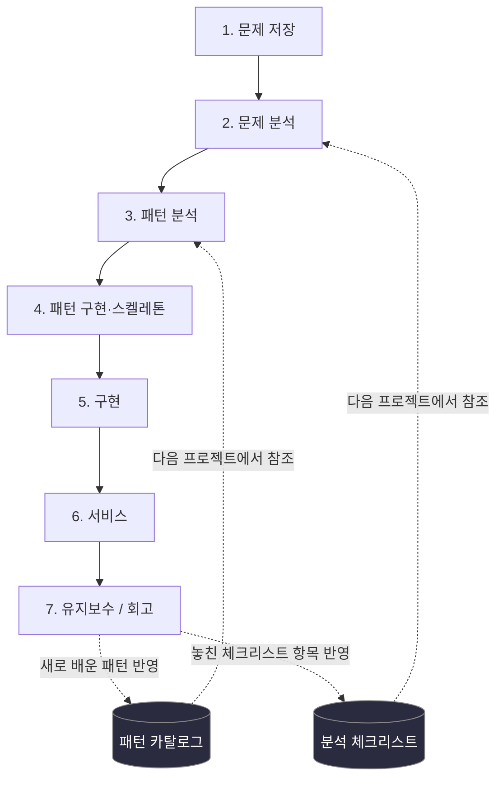
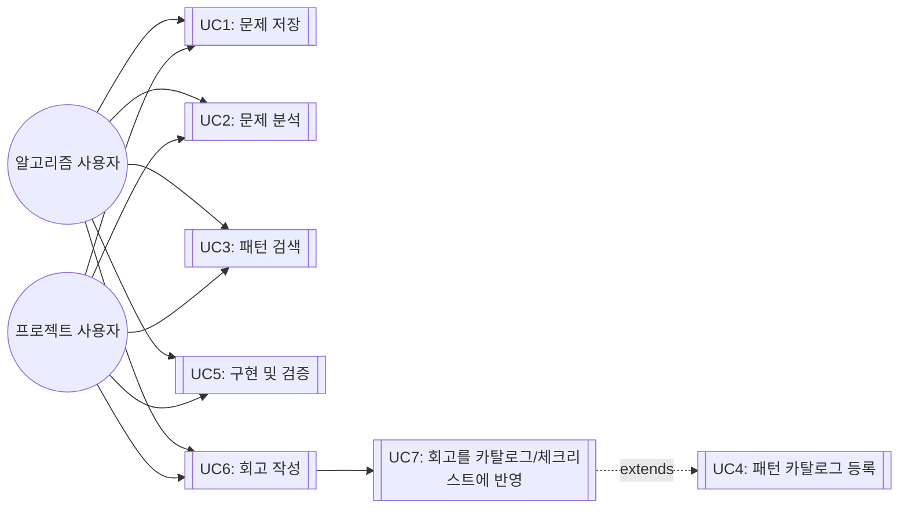

# 나만의 개발 워크플로우 시스템 — 설계 진행 문서

> 이 문서는 진행하면서 계속 업데이트합니다. 새 세션에서 이어서 작업할 때는 이 파일을 먼저 읽고 "현재 위치" 섹션부터 확인하세요.

- 최초 작성: 2026-09-17
- 마지막 업데이트: 2026-09-17

---

## 1. 원문제 정의 (문제 저장/재확인 단계 산출물)

**시나리오**: 새 프로그램/프로젝트를 시작할 때마다 접근 방식이 즉흥적이라, 과거에 배운 패턴이나 실수가 다음 프로젝트에 재사용되지 않는다.

**원하는 결과**: 아래 7단계 프로세스를 만들어서
1. 매번 같은 틀로 진행하고
2. 유지보수 단계에서 얻은 교훈이 패턴 카탈로그/체크리스트로 축적되어 다음 프로젝트에 자동 반영되게 한다.

**적용 대상**: 알고리즘 문제풀이 트랙 / 실무·사이드 프로젝트 트랙 — 두 트랙 모두 틀은 공유하되 각 단계 산출물은 다르게.

**7단계**: 문제 저장 → 문제 분석 → 패턴 분석 → 알고리즘/아키텍처 패턴 구현 → 구현 → 서비스 → 유지보수 (→ 2·3단계로 피드백)

---

## 2. 현재 위치 (Progress Log)

| 단계 | 상태 | 비고 |
|---|---|---|
| 0. 원문제 정의 | ✅ 완료 | 위 1번 섹션 |
| 1. 문제 저장 템플릿 설계 | ✅ 완료 (초안) | ICPC / GitHub Issue Template / IEEE 830 / PRD(Atlassian·Google) 규격 참고. 아래 5번 참고 |
| 2. 문제 분석 (요구사항 정의) | 🟡 진행 중 — 초안 확정, 사용자 검토 대기 | ISO/IEC/IEEE 29148 + FURPS+ + Volere + MoSCoW 적용 완료. 아래 4번 참고 |
| 3. 패턴 분석 (아키텍처/구현 방식 선택) | ⬜ 미착수 | 요구사항 확정 후 진행 |
| 4. 패턴 구현 (스켈레톤) | ⬜ 미착수 | |
| 5. 구현 | ⬜ 미착수 | |
| 6. 서비스 | ⬜ 미착수 | (개인 도구이므로 "실사용 적용"에 해당) |
| 7. 유지보수 | ⬜ 미착수 | |

**다음 액션**: 4번 섹션의 FR1~FR3와 우선순위를 사용자가 확정 → 3단계(패턴 분석: 파일 구조로 갈지, Claude Code 스킬로 갈지 등 결정)로 이동.

---

## 3. 전체 방향 다이어그램



핵심: 1→7은 선형이 아니라 **7단계 회고가 2·3단계 참조 자료(카탈로그/체크리스트)로 역류하는 피드백 루프**입니다. 이 루프가 없으면 원문제("배운 게 재사용 안 됨")가 해결되지 않습니다.

---

## 4. 요구사항 (2단계 문제 분석 산출물, ISO 29148 + FURPS+ + MoSCoW)

### 기능 요구사항

| ID | 요구사항 (조건-주체-행동-대상-제약) | 근거 | 충족기준 | 우선순위 |
|---|---|---|---|---|
| FR1 | 사용자가 새 문제/프로젝트를 시작하면, 시스템은 트랙(알고리즘/실무)에 맞는 저장 템플릿을 제공해야 한다 | 즉흥적 시작 방지 | 필수 필드 미기입 시 다음 단계 진행 불가 | Must |
| FR2 | 사용자가 패턴을 검색하면, 시스템은 태그/키워드로 일치하는 카탈로그 항목을 반환해야 한다 | 과거 패턴 재사용 안 됨 | 로컬 파일 기준 즉시 결과 표시 | Should |
| FR3 | 유지보수 단계 완료 시, 시스템은 회고 내용을 카탈로그/체크리스트에 추가하는 진입점을 제공해야 한다 | 원문제 핵심(피드백 루프) | 회고 후 1회 명령으로 카탈로그 항목 추가 가능 | Must |

### 비기능 요구사항 (FURPS+)

| 범주 | 요구사항 | 측정 기준 |
|---|---|---|
| Usability | 각 단계 템플릿은 5분 이내 작성 가능 | 필드 수 ≤ 7개/단계 |
| Supportability | 새 트랙 추가 시 기존 구조 무변경으로 확장 가능 | 기존 파일 수정 없이 신규 템플릿 파일만 추가 |
| Reliability | 저장 데이터 유실 방지 | 파일 기반 + git 버전관리 |

### 우선순위 요약 (MoSCoW)
- **Must**: FR1, FR3
- **Should**: FR2
- **Could**: 자동 알림/자동 반영
- **Won't (지금은)**: GUI, 웹앱화

---

## 5. 문제 저장 템플릿 초안 (1단계 산출물)

### 알고리즘 트랙 (ICPC 규격 기반)
```
- 제목 / 출처(플랫폼, 문제번호)
- 시나리오(원문 요약)
- 입력 형식 + 제약조건 (수학적 표기)
- 출력 형식
- 예제 입출력 (최소 1쌍)
- 태그(3단계 패턴 분류와 연결)
- 상태(미착수/분석중/풀이완료/복습필요)
```

### 프로젝트 트랙 (GitHub Issue Template 규격 기반)
```
- 요약(Description)
- 재현 절차 또는 배경(Steps to reproduce / Motivation)
- 기대 동작 또는 제안 해결책
- 환경 정보(있다면)
- 대안 검토(기능 요청 시)
```

### PRD (필요 시, 문제 저장+분석 확장판)
- 경량형(Google 원페이지): Feature Overview / Business Justification / Technical Architecture / Security & Compliance / Testing Strategy
- 상세형(Atlassian): 경량형 + Participants / Status / Background & Strategic Fit / User Stories / UX / Scoping

---

## 6. 유즈케이스

### 액터
- **알고리즘 사용자**: 코딩테스트/알고리즘 문제를 푸는 본인
- **프로젝트 사용자**: 실무/사이드 프로젝트를 진행하는 본인
- (두 액터는 동일 인물이지만 트랙에 따라 상호작용이 다르므로 분리)



### 유즈케이스 명세 (핵심 3개, Volere 스타일 요약)

**UC1: 문제 저장**
- 액터: 알고리즘/프로젝트 사용자
- 목적: 새 문제/요구사항을 트랙별 표준 템플릿으로 기록
- 사전조건: 없음 (워크플로우의 시작점)
- 기본 흐름: ① 트랙 선택 → ② 해당 템플릿 필드 작성 → ③ 저장(파일/태그 부여)
- 사후조건: 문제 항목이 검색 가능한 상태로 저장됨
- 관련 요구사항: FR1

**UC3: 패턴 검색**
- 액터: 알고리즘/프로젝트 사용자
- 목적: 현재 문제와 유사한 과거 패턴을 카탈로그에서 찾기
- 사전조건: UC2(문제 분석)에서 태그/유형이 정해짐
- 기본 흐름: ① 키워드/태그 입력 → ② 카탈로그 매칭 → ③ 결과 검토 후 3단계(패턴 분석)에 반영
- 사후조건: 적용할 패턴 후보가 선정됨
- 관련 요구사항: FR2

**UC7: 회고를 카탈로그/체크리스트에 반영**
- 액터: 알고리즘/프로젝트 사용자
- 목적: 이번에 배운 내용을 다음 프로젝트가 참조할 자료로 축적 (원문제 핵심 루프)
- 사전조건: UC6(회고 작성) 완료
- 기본 흐름: ① 회고에서 "새 패턴" 또는 "놓친 체크리스트 항목" 식별 → ② 카탈로그(patterns.md) 또는 체크리스트에 항목 추가 → ③ git 커밋으로 이력 남김
- 사후조건: 카탈로그/체크리스트가 갱신되고, 다음 프로젝트의 UC2·UC3에서 참조 가능
- 관련 요구사항: FR3

---

## 7. 다음 단계 / 열린 질문

- [ ] FR1~FR3 및 우선순위 사용자 확정
- [ ] 3단계(패턴 분석): 이 시스템을 파일 기반 템플릿 모음으로 만들지, Claude Code 커스텀 스킬(SKILL.md)로 만들지 결정
- [ ] 패턴 카탈로그(patterns.md) 포맷 확정 (Volere 카드 스타일 재사용 여부)
- [ ] 회고 → 카탈로그 반영을 "수동(직접 편집)"으로 할지 "반자동(스킬 명령 하나로)"으로 할지 (Could 항목과 연결)

---

## 변경 이력

- 2026-09-17: 최초 작성. 원문제 정의, 요구사항(FR1~FR3), 전체 방향 다이어그램, 유즈케이스 다이어그램/명세 추가.
