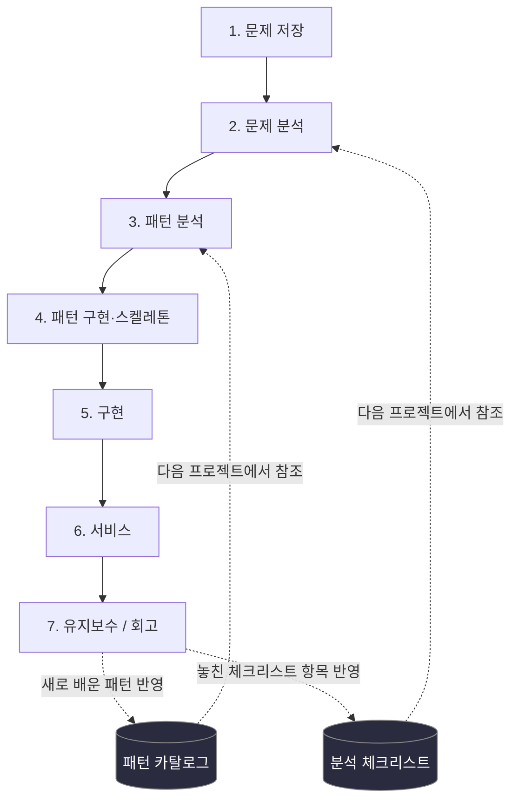
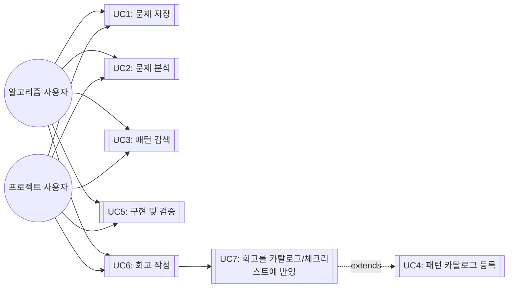

# 개요 — 나만의 개발 워크플로우 시스템

- 최초 작성: 2026-09-17
- 마지막 업데이트: 2026-09-17 (4단계 SKILL.md 스켈레톤 완료)

이 저장소는 "문제 저장 → 문제 분석 → 패턴 분석 → 패턴 구현 → 구현 → 서비스 → 유지보수"라는
7단계 개인 개발 워크플로우를 설계·기록하는 곳입니다. 각 단계는 `docs/` 아래 자기 폴더를 가지며,
그 단계를 수정할 땐 해당 폴더의 md 파일만 고치면 됩니다.

## 원문제 정의

**시나리오**: 새 프로그램/프로젝트를 시작할 때마다 접근 방식이 즉흥적이라, 과거에 배운 패턴이나
실수가 다음 프로젝트에 재사용되지 않는다.

**원하는 결과**: 7단계 프로세스를 만들어서
1. 매번 같은 틀로 진행하고
2. 유지보수 단계에서 얻은 교훈이 패턴 카탈로그/체크리스트로 축적되어 다음 프로젝트에 자동 반영되게 한다.

**적용 대상**: 알고리즘 문제풀이 트랙 / 실무·사이드 프로젝트 트랙 — 두 트랙 모두 틀은 공유하되
각 단계 산출물은 다르게.

## 전체 방향 다이어그램



핵심: 1→7은 선형이 아니라 **7단계 회고가 2·3단계 참조 자료(카탈로그/체크리스트)로 역류하는
피드백 루프**입니다. 이 루프가 없으면 원문제가 해결되지 않습니다.

## 폴더 구조

```
docs/
  00-overview/          이 문서. 원문제, 전체 다이어그램, 진행상황, 유즈케이스
  01-problem-save/      1단계: 문제 저장 템플릿 (트랙별 + PRD)
  02-problem-analysis/  2단계: 요구사항 분석 방법론 + 적용 예시
  03-pattern-analysis/  3단계: 패턴/아키텍처 선택 (ADR-0001 완료)
  04-pattern-implementation/  4단계: 패턴 스켈레톤 구현 (SKILL.md 스켈레톤 완료)
  05-implementation/    5단계: 실제 구현 (미착수)
  06-service/           6단계: 배포/서비스 (미착수)
  07-maintenance/       7단계: 회고 + 피드백 반영 (미착수)
  catalog/              패턴 카탈로그, 분석 체크리스트 (공용 참조 자료, 계속 누적)
```

## 진행상황 (Progress Log)

| 단계 | 상태 | 상세 |
|---|---|---|
| 0. 원문제 정의 | ✅ 완료 | 위 참조 |
| 1. 문제 저장 | ✅ 완료 (초안) | [`docs/01-problem-save/`](../01-problem-save/README.md) |
| 2. 문제 분석 | ✅ 완료 | 수집(BABOK)→명세(EARS)→정량화(Planguage)→우선순위(MoSCoW×Kano)→추적(RTM) 5단계 파이프라인 적용. [`docs/02-problem-analysis/`](../02-problem-analysis/README.md) |
| 3. 패턴 분석 | ✅ 완료 | ADR-0001로 "파일+Claude Code 스킬 하이브리드" 채택. [`docs/03-pattern-analysis/`](../03-pattern-analysis/README.md) |
| 4. 패턴 구현 | ✅ 완료 (스켈레톤) | Walking Skeleton(Cockburn)/Make it work-right-fast 원칙 적용. `.claude/skills/dev-workflow/SKILL.md` 작성, 트랙 자동 인식 스모크 테스트 통과, `sessions/` 폴더 구조 확정. [`docs/04-pattern-implementation/`](../04-pattern-implementation/README.md) |
| 5. 구현 | ⬜ 미착수 | [`docs/05-implementation/`](../05-implementation/README.md) |
| 6. 서비스 | ⬜ 미착수 | [`docs/06-service/`](../06-service/README.md) |
| 7. 유지보수 | ⬜ 미착수 | [`docs/07-maintenance/`](../07-maintenance/README.md) |

**다음 액션**: 5단계 — 새 Claude Code 세션에서 `dev-workflow` 스킬을 실제로 트리거해
명령 1~3(문제 저장/패턴 검색/회고 반영)이 자연어로 잘 동작하는지 검증.

## 유즈케이스

### 액터
- **알고리즘 사용자**: 코딩테스트/알고리즘 문제를 푸는 본인
- **프로젝트 사용자**: 실무/사이드 프로젝트를 진행하는 본인



### 유즈케이스 명세 (핵심 3개, Volere 스타일 요약)

**UC1: 문제 저장** — 사전조건 없음(시작점) → 트랙 선택 → 템플릿 작성 → 저장. 관련: FR1
([`docs/01-problem-save/`](../01-problem-save/README.md))

**UC3: 패턴 검색** — 사전조건: UC2에서 태그/유형 확정 → 키워드/태그로 카탈로그 매칭 →
후보를 3단계에 반영. 관련: FR2 ([`docs/catalog/patterns.md`](../catalog/patterns.md))

**UC7: 회고를 카탈로그/체크리스트에 반영** — 사전조건: UC6 완료 → 새 패턴/놓친 체크리스트
항목 식별 → `catalog/` 파일에 추가 → git 커밋으로 이력 남김. 관련: FR3, 원문제 핵심 루프
([`docs/07-maintenance/`](../07-maintenance/README.md))

## 변경 이력

- 2026-09-17: `docs/` 폴더 구조로 분리. 기존 단일 README 내용을 단계별 폴더로 이동.
- 2026-09-17: 2단계에 BABOK/EARS/Planguage/Kano/RTM 5단계 파이프라인 추가, 3단계에
  ADR-0001(파일+Claude Code 스킬 하이브리드 채택) 추가.
- 2026-09-17: 4단계 스켈레톤 완료 — `.claude/skills/dev-workflow/SKILL.md`,
  `docs/01-problem-save/sessions/` 폴더 구조 확정.
- 2026-09-17: 4단계에 Walking Skeleton(Cockburn)/Tracer Bullet(Hunt & Thomas)/Spike(XP)
  개념과 "Make it work, make it right, make it fast" 원칙 추가.
