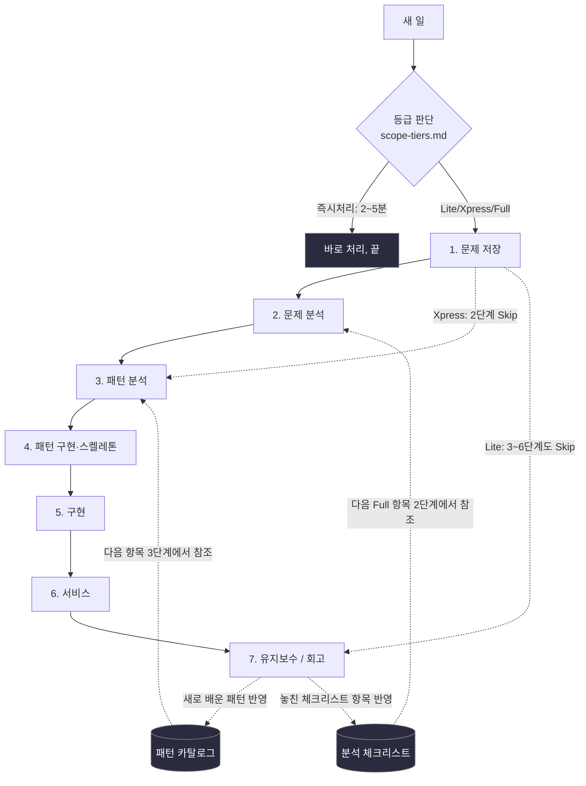
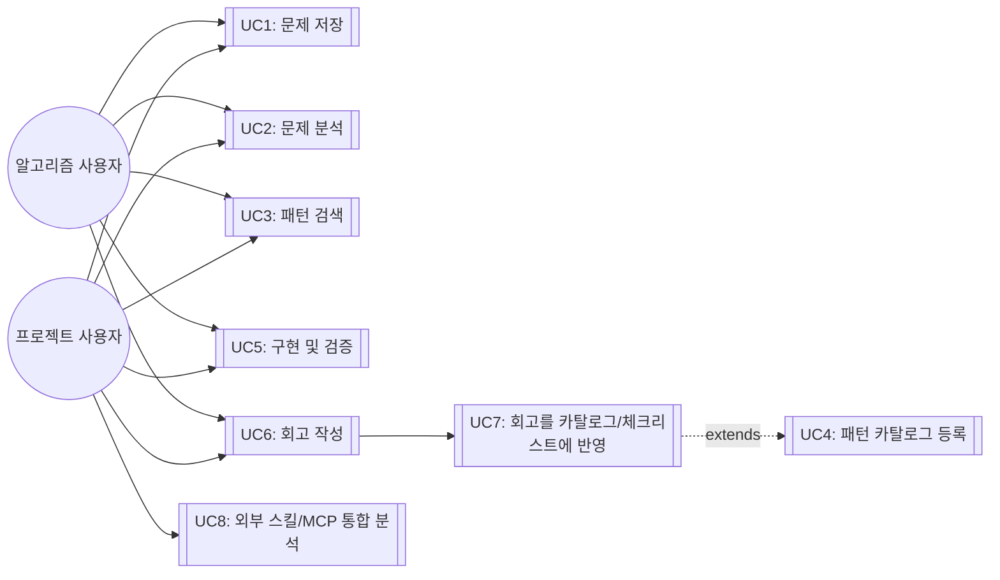

# 개요 — 나만의 개발 워크플로우 시스템

- 최초 작성: 2026-09-17 · 마지막 업데이트: 2026-09-28 (자세한 변경 이력은 [worklog.md](worklog.md))

이 저장소는 "문제 저장 → 문제 분석 → 패턴 분석 → 패턴 구현 → 구현 → 서비스 → 유지보수"라는
7단계 개인 개발 워크플로우를 설계·기록하는 곳입니다. 각 단계는 `docs/` 아래 자기 폴더를 가지며,
그 단계를 수정할 땐 해당 폴더의 md 파일만 고치면 됩니다.

**새 일을 시작하기 전에 → [scope-tiers.md](scope-tiers.md)** (이 7단계를 다 밟을
가치가 있는 일인지, 아니면 Xpress/Lite/즉시처리로 줄일지부터 정하기)

**각 단계를 제대로 마쳤는지 확인하고 넘어가려면 → [gates.md](gates.md)** (진입기준/완료기준
+ Go·Kill·Hold·Recycle 게이트 결정 규정)

## 원문제 정의

**시나리오**: 새 프로그램/프로젝트를 시작할 때마다 접근 방식이 즉흥적이라, 과거에 배운 패턴이나
실수가 다음 프로젝트에 재사용되지 않는다.

**원하는 결과**: 7단계 프로세스를 만들어서
1. 매번 같은 틀로 진행하고
2. 유지보수 단계에서 얻은 교훈이 패턴 카탈로그/체크리스트로 축적되어 다음 프로젝트에 자동 반영되게 한다.

**적용 대상**: 알고리즘 문제풀이 트랙 / 실무·사이드 프로젝트 트랙 — 두 트랙 모두 틀은 공유하되
각 단계 산출물은 다르게.

## 전체 방향 다이어그램



핵심 둘:
1. 1→7은 선형이 아니라 **7단계 회고가 2·3단계 참조 자료(카탈로그/체크리스트)로 역류하는
   피드백 루프**입니다. 이 루프가 없으면 원문제가 해결되지 않습니다.
2. 모든 일이 7단계를 다 밟지도 않습니다 — [scope-tiers.md](scope-tiers.md) 등급에 따라
   Xpress는 2단계를, Lite는 3~6단계까지 건너뜁니다. Two Sum·Contains Duplicate가 실제
   Xpress 사례입니다 ([게이트 로그](gates.md#새-문제프로젝트용-게이트-로그-템플릿) 참고).

## 폴더 구조

```
.claude/skills/dev-workflow/   Claude Code 스킬 — 명령 3개(문제 저장/패턴 검색/회고 반영)
docs/
  00-overview/          이 문서 + gates.md(게이트 규정) + scope-tiers.md(규모 판단)
  01-problem-save/      1단계: 문제 저장 템플릿(트랙별 + PRD) + sessions/(실제 저장된 항목)
  02-problem-analysis/  2단계: 요구사항 분석 방법론 + 적용 범위(경량화 규칙) + 적용 예시
  03-pattern-analysis/  3단계: 패턴/아키텍처 선택 (ADR-0001 완료) + adr/
  04-pattern-implementation/  4단계: 패턴 스켈레톤 구현 (SKILL.md 스켈레톤 완료) + 다이어그램 선택 가이드
  05-implementation/    5단계: TDD + 동등분할·경계값 분석 (7개 항목 적용 완료)
  06-service/           6단계: Twelve-Factor App + 성능 실측 (7개 항목 적용 완료)
  07-maintenance/       7단계: 회고 — 5 Whys + Blameless Postmortem (7개 항목 적용 완료)
  catalog/              패턴 카탈로그, 분석 체크리스트 (공용 참조 자료, 계속 누적)
```

## 진행상황 (Progress Log)

| 단계 | 상태 | 상세 |
|---|---|---|
| 0. 원문제 정의 | ✅ 완료 | 위 참조 |
| 1. 문제 저장 | ✅ 완료 | [`docs/01-problem-save/`](../01-problem-save/README.md) — 세 번째 트랙(`learning-track.md`) 추가로 ADR-0001의 Supportability 제약을 실측 검증. 2026-09-22, 필드 채우기를 일방적 받아쓰기에서 Gause & Weinberg 컨텍스트-프리 질문 기반 인터뷰 방식으로 전환(아래 "다음 액션" 참고) |
| 2. 문제 분석 | ✅ 완료 | 수집(BABOK)→명세(EARS)→정량화(Planguage)→우선순위(MoSCoW×Kano)→추적(RTM) 5단계 파이프라인 적용. 2026-09-28, FR4(외부 스킬/MCP 통합 분석 — 명령 4)를 EARS·Planguage·MoSCoW×Kano·RTM 전부에 추가해 "우리 프로젝트가 기존 체계를 침범당하지 않으면서 확장 가능한가"를 정식 요구사항으로 편입. [`docs/02-problem-analysis/`](../02-problem-analysis/README.md) |
| 3. 패턴 분석 | ✅ 완료 | ADR-0001로 "파일+Claude Code 스킬 하이브리드" 채택. 두 번째 Full 프로젝트에서 ADR-0003(Microkernel)으로 이 저장소 최초의 ATAM 실사용. [`docs/03-pattern-analysis/`](../03-pattern-analysis/README.md) |
| 4. 패턴 구현 | ✅ 완료 (스켈레톤) | Walking Skeleton(Cockburn)/Make it work-right-fast 원칙 적용. `.claude/skills/dev-workflow/SKILL.md` 작성, 트랙 자동 인식 스모크 테스트 통과, `sessions/` 폴더 구조 확정. 세 번째 항목 [Valid Parentheses](../01-problem-save/sessions/algorithm-track/2026-09-19-valid-parentheses.md)로 "검색 실패→표준 카탈로그 폴백" 경로 첫 실증. 2026-09-28, `.claude/`를 라우터(`CLAUDE.md`)+조건부 규칙(`rules/`)+기계적 강제(`hooks/`)+격리 실행(`agents/verify.md`)+절차 분리(`SKILL.md`/`PROCEDURE.md`) 5개 층으로 재구성하고, 기준 파일 간 상호 참조를 관리하는 `rules/consistency.md`를 추가(`main`/`team`/`template`/공개 템플릿 4곳 동기화, 자세한 내용은 [worklog.md](worklog.md)). [`docs/04-pattern-implementation/`](../04-pattern-implementation/README.md) |
| 5. 구현 | 🟡 진행 중 | 일곱 항목 전체 TDD 구현 완료(7개 구현 48개 테스트 통과, [`implementations/`](../../implementations/) 참고). [`docs/05-implementation/`](../05-implementation/README.md) |
| 6. 서비스 | 🟡 진행 중 | 알고리즘 트랙 5건 성능 실측 + 프로젝트 트랙 2건 Planguage Goal 실증. 벤치마크마다 추세로 최악 케이스 검증하는 습관 정착. [`docs/06-service/`](../06-service/README.md) |
| 7. 유지보수 | 🟡 진행 중 | 여덟 항목 모두 회고 완료(1→7 완주) → `catalog/checklist.md` 6개 항목, `catalog/patterns.md`에 패턴 3개(해시맵 원패스 탐색 — 3회 재사용, 스택 기반 매칭, 한 번 순회 최솟값 추적) + 프로젝트 트랙 패턴 첫 재사용(환경변수 Config). [`docs/07-maintenance/`](../07-maintenance/README.md) |

**다음 액션**: Xpress 알고리즘 5건 + Full 프로젝트 2건 + Lite 학습 1건, 총
8개 항목이 1→7을 완주함(전체 목록: [sessions/README.md](../01-problem-save/sessions/README.md)
트래커). 세 번째 트랙(학습 트랙) 추가로 ADR-0001의 Supportability 제약을
실측: `.claude/skills/dev-workflow/SKILL.md`·모든 코드(`implementations/`)
**0개 수정**, `learning-track.md` 등 신규 파일만 추가로 확장됨(핵심 로직
기준. 트래커/진행상황 표처럼 항목을 저장할 때마다 갱신하는 기록용 파일은
트랙 신규 여부와 무관하게 매번 바뀌므로 이 Goal의 "기존 파일" 범위에서
제외 — 이 구분 자체가 이번에 명확해진 것). 같은 김에 Lite 등급도 처음
실사용함. 즉시처리(GTD Two-Minute Rule)도 SKILL.md 배너의 스테일 숫자를
그 자리에서 바로 고치며 실측(19초) — 이걸로 scope-tiers.md 네 등급이 전부
실사용으로 확인됨.

사용자 요청으로 명령 1(문제 저장)의 필드 채우기 방식을 바꿨다 —
사용자가 준 설명을 그대로 받아 적는 대신, Gause & Weinberg의 컨텍스트-프리
질문으로 되물어서 채운다([`docs/01-problem-save/`](../01-problem-save/README.md)의
"필드는 어떻게 채우는가" 절). 아직 실전 항목으로 검증되지는 않았다 — 다음
항목(특히 Full 등급 프로젝트)을 저장할 때가 검증 시점.

## 유즈케이스

### 액터
- **알고리즘 사용자**: 코딩테스트/알고리즘 문제를 푸는 본인
- **프로젝트 사용자**: 실무/사이드 프로젝트를 진행하는 본인



### 유즈케이스 명세 (핵심 3개, Volere 스타일 요약)

**UC1: 문제 저장** — 사전조건 없음(시작점) → 트랙 선택 → 템플릿 작성 → 저장. 관련: FR1
([`docs/01-problem-save/`](../01-problem-save/README.md))

**UC3: 패턴 검색** — 사전조건: UC2에서 태그/유형 확정 → 키워드/태그로 카탈로그 매칭 →
후보를 3단계에 반영. 관련: FR2 ([`docs/catalog/patterns.md`](../catalog/patterns.md))

**UC7: 회고를 카탈로그/체크리스트에 반영** — 사전조건: UC6 완료 → 새 패턴/놓친 체크리스트
항목 식별 → `catalog/` 파일에 추가 → git 커밋으로 이력 남김. 관련: FR3, 원문제 핵심 루프
([`docs/07-maintenance/`](../07-maintenance/README.md))

**UC8: 외부 스킬/MCP 통합 분석** — 사전조건 없음(7단계 루프 밖에서 언제든 트리거) →
도구별로 건드리는 경로·중복/충돌 분석 → 채택/격리/제거 판정 →
`docs/catalog/external-tools.md`에 기록. 관련: FR4
([`.claude/rules/external-integration.md`](../../.claude/rules/external-integration.md))

## 왜 지금 이런 모양인지

이 문서에는 결과만 담았습니다. 어떤 시행착오를 거쳐 지금 구조가 됐는지는
[worklog.md](worklog.md)에 날짜순으로 정리돼 있습니다.
