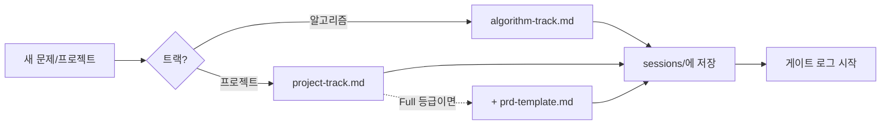

# 1단계: 문제 저장

> 상태: ✅ 완료 (템플릿 + `sessions/` 폴더 구조 확정)

새 문제/프로젝트를 시작할 때 가장 먼저 채우는 단계. 트랙에 따라 템플릿이 다릅니다.

| 파일 | 대상 | 근거 규격 |
|---|---|---|
| [algorithm-track.md](algorithm-track.md) | 알고리즘 문제풀이 | ICPC 문제 명세 규격 |
| [project-track.md](project-track.md) | 실무/사이드 프로젝트 | GitHub Issue Template 규격 |
| [prd-template.md](prd-template.md) | Full 등급 프로젝트 트랙 전용 확장판 | Google/Atlassian PRD |

PRD를 언제 쓰는지는 [scope-tiers.md](../00-overview/scope-tiers.md) 등급으로 정합니다.

## 이 단계에서 지켜야 할 규칙 (IEEE 830 기반)

**IEEE 830**(정식 명칭: *IEEE Recommended Practice for Software Requirements
Specifications*)은 소프트웨어 요구사항 문서의 품질 기준을 정한 표준입니다. 이 저장소
전체(1·2단계)에서 아래 두 규칙을 공통으로 가져다 씁니다.

- 하나의 요구사항/설명 문장에는 하나의 동작만 담는다.
- "빠르다/사용하기 편하다/견고하다" 같은 정성적 표현은 쓰지 않는다. 항상 측정 가능한 숫자로 대체.

## 사용 방법

새 문제/프로젝트가 생기면 해당 트랙 파일을 복사해서 (예: `algorithm-track.md` →
`sessions/algorithm-track/2026-09-20-two-sum.md` 같은 실제 항목 파일) 채우세요. 이 폴더
안의 파일은 "템플릿 원본"이고, 실제로 쌓이는 항목들은 [`sessions/`](sessions/README.md)에
`sessions/<트랙파일명>/<YYYY-MM-DD>-<슬러그>.md` 규칙으로 트랙별 저장합니다. 저장한 뒤엔
[`.claude/skills/dev-workflow/SKILL.md`](../../.claude/skills/dev-workflow/SKILL.md)의
안내를 따라 [게이트 로그](../00-overview/gates.md)도 함께 시작합니다.

왜 이 규칙으로 정해졌는지는 [worklog.md](../00-overview/worklog.md)에 있습니다.
