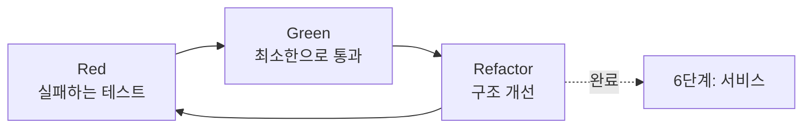

# 5단계: 구현

> 상태: 🟡 진행 중 — [Two Sum](../../implementations/algorithm-track/two-sum/),
> [Contains Duplicate](../../implementations/algorithm-track/contains-duplicate/) 완료

패턴 스켈레톤을 실제 문제/요구사항에 맞게 완성하는 단계.



## 방향을 정하는 표준 개념

| 개념 | 문서 | 핵심 |
|---|---|---|
| 개발 리듬 | [01-tdd-red-green-refactor.md](01-tdd-red-green-refactor.md) | Kent Beck의 TDD Red-Green-Refactor 순환. 알고리즘 트랙은 "Refactor 자리에 최적화"로 변형 |
| 테스트 설계 | [02-boundary-value-equivalence.md](02-boundary-value-equivalence.md) | ISO/IEC/IEEE 29119의 동등분할 + 경계값 분석으로 "뭘 엣지 케이스로 볼지" 체계적으로 뽑기 |

## 코드는 어디에 두는가

`docs/`는 방법론·기록용이라 실제 코드는 저장소 최상위 `implementations/`에 둡니다 —
1단계 `sessions/`와 같은 이름 규칙입니다.

```
implementations/<트랙파일명>/<세션 슬러그>/
  solution.py         # 구현 (알고리즘 트랙: 브루트포스 + 최적화 버전 둘 다 남김)
  test_solution.py     # 단위 테스트 + 경계값/차등 테스트
```

## 이 단계에서 하는 일

- 완성 코드 + 단위 테스트 (Red-Green-Refactor 순환으로)
- **Full 등급**: 엣지 케이스는 2단계 EARS Unwanted-behavior 요구사항 기준
- **Xpress/Lite 등급** (2단계를 생략한 경우): 2단계 명세가 없으므로, 대신
  동등분할/경계값 분석만으로 엣지 케이스를 뽑고 브루트포스 대비 차등 테스트로 보강
- 완료 후 [6단계](../06-service/README.md)로 전달

## 실제 사례

두 문제 모두 같은 순서(Red → Green → Refactor)로 진행했고, 2단계를 생략한 Xpress
등급이라 경계값 분석 + 브루트포스 대비 차등 테스트로 엣지 케이스를 대신했습니다.

| 문제 | 코드 | Refactor(최적화) | 테스트 |
|---|---|---|---|
| [Two Sum](../../implementations/algorithm-track/two-sum/) | O(n²) → O(n) | [해시맵 원패스 탐색](../catalog/patterns.md) | 5개 (길이 하한, 정답이 양끝, 음수, 차등 테스트 200회) |
| [Contains Duplicate](../../implementations/algorithm-track/contains-duplicate/) | O(n²) → O(n) | 같은 패턴의 해시셋 변형 | 6개 (길이 하한 1, 중복이 양끝, 음수, 차등 테스트 200회) |

**Contains Duplicate가 확인해준 것**: `catalog/patterns.md`의 패턴이 "Two Sum
전용"이 아니라 정말로 재사용 가능한 일반 패턴이라는 것 — 완전히 다른 문제에 같은
설명("배열을 한 번 순회하며 지금까지 본 값을 저장, O(1) 확인")을 그대로 적용해서
풀렸습니다.
