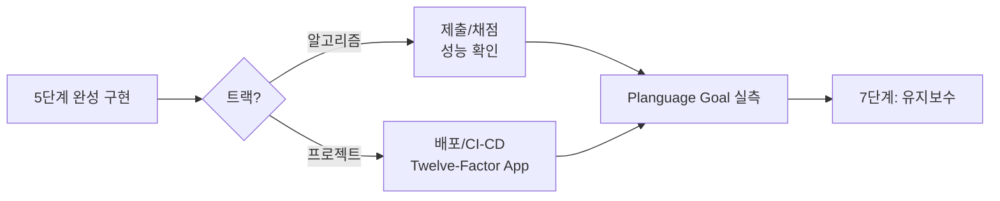

# 6단계: 서비스

> 상태: ⬜ 미착수

완성된 구현을 실제로 사용 가능한 형태로 내보내는 단계. **2단계에서 정한 Planguage
Goal을 실측하는 자리**이기도 합니다 — 정량화만 해놓고 실측을 안 하면 2단계 작업이
무의미해집니다.

## 방향을 정하는 표준 개념

| 트랙 | 개념 | 핵심 |
|---|---|---|
| 프로젝트 | [01-twelve-factor-app.md](01-twelve-factor-app.md) | Heroku Twelve-Factor App 중 개인 프로젝트에 우선 적용할 5가지(Config/Backing Services/Build-Release-Run/Processes/Logs) |

## 이 단계에서 채울 내용 (예정)

- **알고리즘 트랙**: 제출/채점, 성능(런타임/메모리) 확인
- **프로젝트 트랙**: 배포, CI/CD, 모니터링 (Twelve-Factor 원칙 적용)
- 완료 후 [7단계](../07-maintenance/README.md)로 전달

## Planguage Goal 실측

[2단계](../02-problem-analysis/03-quantification-planguage.md)에서 비기능 요구사항마다
정한 `Scale/Meter/Goal`을 여기서 실제로 측정합니다.

| Goal 예시 | 측정 방법 |
|---|---|
| Usability: "5분 이내 작성" | 실제 사용해보며 타이머로 측정 |
| Supportability: "새 트랙 추가 시 기존 파일 0개 수정" | 다음 트랙 추가 커밋에서 `git diff --stat`으로 확인 |

측정 결과가 Goal 미달이면, 그 사실 자체가 7단계 회고의 입력이 됩니다.
