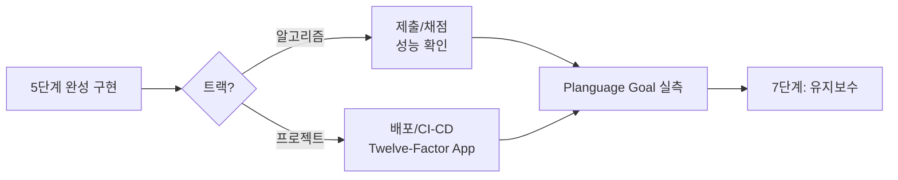

# 6단계: 서비스

> 상태: 🟡 진행 중 — 5개 항목 성능 실측/Planguage Goal 실증 완료. 전체 목록은
> [sessions/README.md 트래커](../01-problem-save/sessions/README.md) 참고.

완성된 구현을 실제로 사용 가능한 형태로 내보내는 단계. **2단계에서 정한 Planguage
Goal을 실측하는 자리**이기도 합니다 — 정량화만 해놓고 실측을 안 하면 2단계 작업이
무의미해집니다.

## 방향을 정하는 표준 개념

| 트랙 | 개념 | 핵심 |
|---|---|---|
| 프로젝트 | [01-twelve-factor-app.md](01-twelve-factor-app.md) | Heroku Twelve-Factor App 중 개인 프로젝트에 우선 적용할 5가지(Config/Backing Services/Build-Release-Run/Processes/Logs) |

## 이 단계에서 하는 일

- **알고리즘 트랙**: 제출/채점 대신 성능(런타임) 실측 → 아래 "알고리즘 트랙 성능 실측"
- **프로젝트 트랙**: Twelve-Factor 원칙 적용 + Planguage Goal 실측 → 아래 두 섹션
- 완료 후 [7단계](../07-maintenance/README.md)로 전달

> **이 저장소의 한계**: 실제 LeetCode 제출은 이 세션에서 할 수 없습니다(계정/브라우저
> 접근이 필요). "채점" 대신 **정확성은 5단계 테스트로, 성능은 아래 실측으로** 대체합니다.

## 알고리즘 트랙 성능 실측

각 구현 폴더의 `benchmark.py`로 제약조건 상한 근처에서 브루트포스 대비 최적화의
실제 속도 차이를 측정했습니다.

| 문제 | 브루트포스 O(n²) | 최적화 O(n) | 비고 |
|---|---|---|---|
| Two Sum (n=10,000, 정답이 배열 끝) | 1842.6 ms | 1.147 ms | 약 1600배 |
| Contains Duplicate (n=100,000, 중복 없음) | (직접 측정 비현실적 — 추세로 추정 시 약 1~2분) | 5.94 ms | n=1000/2000/4000에서 9.2/37.5/151.5 ms로 4배씩 증가 확인(O(n²) 추세) |
| Valid Parentheses (n=10,000, 완전 중첩) | 179.2 ms | 0.383 ms | 약 468배. n=1000~8000에서 4배씩 증가 확인 후 상한에서 측정 |
| Contains Duplicate II (n=100,000, 중복 없음) | (직접 측정 비현실적 — 추세로 추정 시 1~2분) | 10.57 ms | n=500~4000에서 약 4배씩 증가 확인(O(n²) 추세) |

Contains Duplicate 계열은 브루트포스를 제약조건 상한(10^5)에서 직접 돌리면 비현실적이라,
작은 n에서 증가 추세만 확인하고 최적화 버전만 실제 상한에서 측정했습니다.
Valid Parentheses부터는 Two Sum의 교훈(주장한 "최악 케이스"가 실제로는 아니었던 것)을
반영해, 상한 측정 전에 여러 크기에서 추세부터 확인하는 게 관행이 됐습니다.

## Planguage Goal 실측

[2단계](../02-problem-analysis/03-quantification-planguage.md)에서 비기능 요구사항마다
정한 `Scale/Meter/Goal`을 여기서 실제로 측정합니다.

| Goal 예시 | 측정 방법 |
|---|---|
| Usability: "5분 이내 작성" | 실제 사용해보며 타이머로 측정 |
| Supportability: "새 트랙 추가 시 기존 파일 0개 수정" | 다음 트랙 추가 커밋에서 `git diff --stat`으로 확인 |

측정 결과가 Goal 미달이면, 그 사실 자체가 7단계 회고의 입력이 됩니다.

## 프로젝트 트랙 실제 사례 — 카탈로그 검색 CLI

위의 Two Sum/Contains Duplicate는 알고리즘 트랙이라 Planguage Goal 자체가
없었는데, [카탈로그 검색 CLI](../../implementations/project-track/catalog-search-cli/)가
이 저장소에서 Planguage Goal 실측 규칙을 **실제로 적용한 첫 사례**입니다.

| Goal | 목표 | 실측 |
|---|---|---|
| Usability: 검색 소요시간 | 0.5초 이내 | 34.0 ms |
| Supportability: 외부 패키지 수 | 0개 | 0개(표준 라이브러리만) |

Twelve-Factor App 중 실제로 적용된 것: Config(`CATALOG_ROOT` 환경변수),
Backing Services(카탈로그 경로를 붙였다 뗄 수 있는 자원으로 취급), Processes
(무상태), Logs(표준출력).
